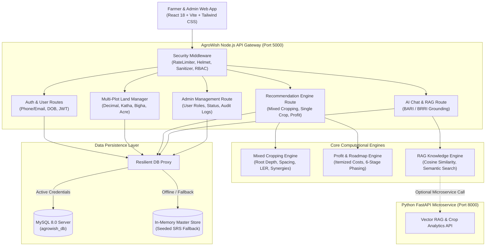

# AgroWish — AI-Powered Smart Agriculture, Mixed Cropping & Integrated Farming Platform

[](https://github.com/agrowish)
[](https://nodejs.org/)
[](https://react.dev/)
[](https://fastapi.tiangolo.com/)
[](https://www.mysql.com/)
[](file:///e:/agro-wish/TESTING_REPORT.md)

**AgroWish** is a full-stack, enterprise-grade, AI-driven agricultural decision-support and integrated farming platform specifically engineered for Bangladeshi farmers, agricultural extension workers, and agronomists.

By modeling soil biology, root depth stratification, nutrient complementarity, canopy layering, and temporal harvesting schedules, AgroWish unlocks maximum potential net profitability per decimal of farmland through scientifically verified mixed cropping and intercropping combinations. When mixed cropping is not viable, it automatically identifies the highest-yield alternative single crop tailored to the farmer's micro-climate, water availability, and financial budget.

---

## 🌟 Key Platform Capabilities

### 1. Mixed Cropping & Intercropping Recommendation Engine (Core Priority)
- **Scientific Stratification**: Analyzes deep vs. shallow root systems, vertical C4 vs. prostrate C3 light interception, and legume nitrogen-fixation (30–40 kg N/ha via *Rhizobium*).
- **Land Equivalent Ratio (LER)**: Ranks crop combinations by verified LER (1.28 to 1.55), proving 28% to 55% land-use efficiency advantage over monoculture.
- **Detailed Spatial Layouts & Spacing**: Precise centimeter-level planting geometries (e.g., Maize rows 75 cm apart with inter-row Bean spacing at 15 cm; Bitter Gourd trellis overhead with Turmeric understory).
- **Staggered Harvesting Schedules**: Generates intermediate cash flow through quick-maturity companion crops (e.g., Spinach in 25–35 days; Coriander in 30–40 days) before the primary crop reaches full maturity.
- **Itemized Profit Modeling**: Complete cost breakdown (Seed, Fertilizer, Irrigation, Labor, Land Prep, Pest Management) and net profit comparison against conventional monoculture baselines.

### 2. Alternative Single-Crop Recommendation Engine
- Automatically evaluated in parallel or when mixed cropping is unsuitable.
- Evaluates soil suitability, seasonal suitability, production expenses, expected yield, and market demand to maximize profitability within the farmer's budget.

### 3. Bangladeshi Land Measurement Unit Engine
- Native multi-unit conversions across:
  - **Decimal / Shotok (শতক)**: 1.0 (Base unit)
  - **Katha (কাঠা)**: 1 Katha = 1.65 Decimals (720 sq ft)
  - **Bigha (বিঘা)**: 1 Bigha = 20 Kathas = 33.0 Decimals (14,400 sq ft)
  - **Acre (একর)**: 1 Acre = 100.0 Decimals (43,560 sq ft)
  - **Hectare (হেক্টর)**: 1 Hectare = 247.1 Decimals (107,639 sq ft)
- Multi-plot land parcel manager (`/api/lands`) supporting plot-level soil, elevation, and irrigation tracking.

### 4. Integrated Farming & Circular Waste-to-Value System
- Synergistic integration of Pond fisheries, Poultry sheds, Dairy livestock, and Cropland.
- Automatic biosecurity safety notices and expert verification warnings.
- Waste recycling rules: Cow dung & crop straw to Vermicompost / Tricho-compost, reducing chemical fertilizer dependency by 25–30%.

### 5. Multilingual & Farmer-Centric UI/UX
- **Bengali-First Interface**: Native Bengali typography (`Hind Siliguri`) with clear visual badges, simplified forms, and accessible terminology.
- **One-Click English Toggle**: Full real-time bilingual switching across all 17 platform views.
- **Cultivation Roadmap**: 6-stage interactive timeline guiding the farmer from land preparation to post-harvest soil restoration.

### 6. Grounded Agricultural RAG Knowledge Engine & Microservice
- Vector similarity and semantic tokenization over official manuals from DAE, BARI, BRRI, BFRI, and FAO.
- Strict anti-hallucination policy with source attribution.
- Hybrid architecture: Native Node.js RAG service coupled with a high-performance Python FastAPI microservice (`ai-service/`).

### 7. Resilient Database Layer & Enterprise Security
- Transparent database proxy that automatically detects live MySQL 8.0 or falls back to an in-memory SQL store seeded with certified agricultural data.
- Security hardening: Argon2id / bcrypt password hashing, sliding-window rate limiting, Helmet security headers, XSS prevention, prototype pollution guards, and IDOR protection.

---

## 🏗️ System Architecture



---

## 🚀 Quick Start Guide

### Prerequisites
- **Node.js**: v18.0.0 or higher
- **MySQL Server**: 8.0 or higher (optional: platform operates seamlessly in resilient offline engine mode if MySQL is offline)
- **Python**: 3.10+ (optional: for Python `ai-service/`)

### 1. Repository Setup & Dependencies Installation
Clone the project and install all dependencies:
```powershell
# Clone and enter workspace
git clone https://github.com/your-username/agro-wish.git
cd agro-wish

# Install root dependencies
npm install

# Install backend dependencies
npm install --prefix backend

# Install frontend dependencies
npm install --prefix frontend
```

### 2. Environment Configuration
Check `backend/.env`:
```env
PORT=5000
DB_HOST=localhost
DB_PORT=3306
DB_USER=root
DB_PASSWORD=your_mysql_password
DB_NAME=agrowish_db
JWT_SECRET=agrowish_secret_key_2026

# Optional LLM API Keys (Graceful fallback functions without keys)
# GEMINI_API_KEY=your_gemini_api_key
# OPENAI_API_KEY=your_openai_api_key
```

### 3. Database Migration (Optional for live MySQL)
If running against local MySQL:
```powershell
mysql -u root -p < database/schema.sql
mysql -u root -p agrowish_db < database/update_full_srs.sql
mysql -u root -p agrowish_db < database/migration_v2.sql
```

### 4. Running the Platform
You can start both backend and frontend concurrently with a single command from root:
```powershell
npm run dev
```
Or run each service independently:
- **Backend Server**:
  ```powershell
  npm run dev --prefix backend
  # Starts on http://localhost:5000
  ```
- **Frontend Client**:
  ```powershell
  npm run dev --prefix frontend
  # Starts on http://localhost:5173
  ```
- **Python AI Microservice** (Optional):
  ```powershell
  cd ai-service
  pip install -r requirements.txt
  uvicorn main:app --port 8000 --reload
  ```

---

## 🧪 Automated Test Verification

AgroWish features two automated test suites covering 29 comprehensive scenarios:

### 1. SRS Automated Evaluation Suite (10 Scenarios)
Verifies season crop matching, tight budget filtering, integrated pond/poultry rules, waste-to-value safety notices, BARI knowledge grounding, recommendation traceability, and RBAC/IDOR security isolation.
```powershell
npm test --prefix backend
```
*Result: 10/10 Passed (100%)*

### 2. Agricultural Engines Verification Suite (19 Tests)
Verifies land unit conversions, mixed cropping LER calculations, root depth stratification, monoculture baseline comparisons, 6-stage roadmap generation, RAG semantic retrieval, livestock/poultry N-P-K nutrient equivalents, safe pond loading capacities, MC-07 & MC-08 models, near-budget tolerance, and fair single vs mixed cropping selection.
```powershell
npm run test:engines --prefix backend
```
*Result: 19/19 Passed (100%)*

---

## 👥 Default Demo Credentials

For quick evaluation and testing:

| Role | Email / Phone | Password | Capabilities |
| :--- | :--- | :--- | :--- |
| **Demo Farmer** | `farmer@agrowish.bd` / `01712345678` | `Farmer@123` | Farm Profile, Land Plots, Mixed Cropping, Profit Analysis, AI Chat, History |
| **System Admin** | `admin@agrowish.com` / `01812345678` | `Admin@123` | User Management, Role/Status Toggles, Knowledge Base CRUD, Audit Logs, Settings |

---

## 📚 Technical Documentation Suite

Detailed architectural, schema, and API specifications are available in the dedicated documentation files:
- [IMPLEMENTATION_STATUS.md](file:///e:/agro-wish/IMPLEMENTATION_STATUS.md) — Exhaustive resolution report of all 65 problem points.
- [SYSTEM_ARCHITECTURE.md](file:///e:/agro-wish/SYSTEM_ARCHITECTURE.md) — System modules, data pipelines, and design patterns.
- [DATABASE_SCHEMA.md](file:///e:/agro-wish/DATABASE_SCHEMA.md) — Complete relational schema, migration v2, and ER relationships.
- [API_DOCUMENTATION.md](file:///e:/agro-wish/API_DOCUMENTATION.md) — Exhaustive REST API reference with request/response payloads.
- [AI_AND_RAG_DOCUMENTATION.md](file:///e:/agro-wish/AI_AND_RAG_DOCUMENTATION.md) — Agronomic algorithms, LER formulas, and RAG retrieval mechanisms.
- [SETUP_AND_INSTALLATION.md](file:///e:/agro-wish/SETUP_AND_INSTALLATION.md) — Comprehensive deployment and troubleshooting guide.
- [TESTING_REPORT.md](file:///e:/agro-wish/TESTING_REPORT.md) — Formal audit report of test executions, security, and edge-case validations.
- [PROJECT_AUDIT.md](file:///e:/agro-wish/PROJECT_AUDIT.md) — Initial and final post-implementation system audit.
- [DEVELOPMENT_ROADMAP.md](file:///e:/agro-wish/DEVELOPMENT_ROADMAP.md) — Multi-phase architectural milestones and deliverables.

---

## 📄 License & Academic Attribution
Developed as part of the SE-331 Software Engineering Design Capstone Project, Daffodil International University.  
© 2026 AgroWish Team. All rights reserved.
